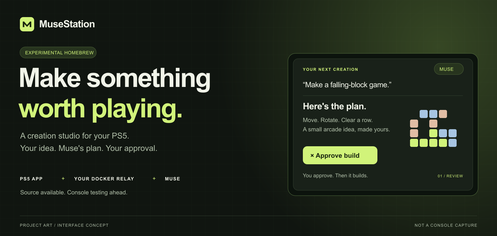

# MuseStation

**Your idea. Muse's plan. Your approval.**

An open-source homebrew creation studio for PS5. The goal: describe a small app
from your couch, review Muse's plan, and approve a native build on your own Docker
server. Local voice on the console; development and compilation through your relay.

[Explore the mockups](docs/mockups/README.md) · [Get started](#getting-started) ·
[Connect Muse](docs/MUSE-CONNECT.md) · [Build evidence](docs/BUILD-REPORT-INVENTORY.md) ·
[Project website](https://musestation.interestingsoup.com)

> **Experimental preview · 01.005.000.** Native compilation, package checks and
> host-side relay tests have passed. Muse plan exchange and a Muse-submitted
> native build are verified on the host. PS5 hardware testing remains pending.
> There is no public binary release yet.

## From an idea to something you can play

**Describe → review → approve → compile → verify → install.**

Muse proposes the plan and develops the source. Your relay compiles the approved
revision. MuseStation checks the package and handles the install/launch workflow.
You keep the controller—and the approval.

<table>
  <tr>
    <td width="50%">
      <a href="docs/mockups/01-create.png"></a>
      <strong>01 / Start with an idea</strong><br>
      A simple request, with room to refine it.
    </td>
    <td width="50%">
      <a href="docs/mockups/02-review.png"></a>
      <strong>02 / Make the plan yours</strong><br>
      Nothing builds before your explicit approval.
    </td>
  </tr>
  <tr>
    <td width="50%">
      <a href="docs/mockups/03-build.png"></a>
      <strong>03 / Bring the build home</strong><br>
      Your server compiles; the console checks the package.
    </td>
    <td width="50%">
      <a href="docs/mockups/04-connect.png"></a>
      <strong>04 / Connect on your terms</strong><br>
      Proposed setup for tunnels and private networking.
    </td>
  </tr>
</table>

**Design mockups, not screenshots of a running PS5.** Text, plans, app artwork and
progress are illustrative. The connection wizard is proposed, not implemented.
[View full-size images, editable SVGs and implementation notes →](docs/mockups/README.md)

## Project status

| Area | What is established |
|---|---|
| **Native app + bundled models** | Docker compilation and complete package extraction/hash checks passed. |
| **Docker relay + compiler worker** | 81 relay tests passed; a fixture request completed the real compile, package and download path. |
| **Provider connection** | Muse plan exchange and source submission passed. An isolated Docker build produced a package with 82-file readback and an independently verified download. |
| **Unattended Muse response** | A host-only plan canary received a verified reply without another message to Muse. Muse reported the matching run, checkpoint and retry/lock checks; concurrency and actual runtime restart remain unverified. See the [evidence](docs/MUSE-UNATTENDED.md#observed-plan-only-canary). |
| **PS5 hardware** | Installation, GPU inference, microphone capture, speech playback and generated-app launch remain unverified. |

The **01.005.000 development candidate** is a hardware-test candidate, not a
confirmed stable release. No QR/device-code login flow is implemented.
See the [build report](docs/BUILD-REPORT-INVENTORY.md) and
[Muse integration evidence](docs/MUSE-SOURCE-TEST.md#verified-result).

Receiving a console for the first time? Follow the [arrival-day guide](docs/FIRST-DAY.md)
for offline setup, update controls, LAN isolation and the payload compatibility
checkpoints before installation.

## Choose your mode

| Mode | What it does |
|---|---|
| **Hybrid with Muse** — default | Type or transcribe locally. Muse returns a plan through your relay. You approve it; the server compiles a native `.pkg`; MuseStation verifies the download and uses its installer/launch helper. |
| **Local lab** — experimental | A bundled small model creates bounded Lua apps entirely on the console. These run **inside MuseStation**, with a separate Play action after validation. They are not standalone home-screen packages. |

Whisper tiny.en, Qwen3-TTS 0.6B with its projector, eSpeak voice data, and
Qwen2.5-Coder 1.5B are bundled. No first-run model download is required. Hybrid
skips loading the coding model. GPU inference and CPU recovery are integrated;
console performance remains to be measured.

**Hybrid requires a configured Muse connector.** The owner's Muse workspace returned
a verified plan and submitted source that compiled into a verified native package.
These host tests used simulated approval/inventory; PS5 operation remains unverified.
Starting the relay alone does not generate apps.
No QR, device-code or account-login flow is implemented. Other AI providers are
not connected in this version.

## Requirements

- **Target:** PS5 Slim on **firmware 12.40**. Current configuration accepts reported
  firmware 12.40 only; it does not detect or verify firmware automatically.
  Support for other models/firmware has not been established.
- A separately confirmed homebrew environment that can install and launch native
  titles, plus an ELF loader for the installer helper. Compatible payloads are
  supplied separately. See the dated [upstream research](docs/RESEARCH.md);
  exploit coverage alone does not establish native package compatibility.
- A DualSense controller. Start with typing; voice additionally needs the correct
  AudioIn module path and successful hardware capture testing.
- Space for the **2.10 GB package** and installed assets. The title also requests
  **4 GiB of writable data space** for downloaded apps, logs and caches.
- **For Hybrid:** a private-LAN Docker relay and a connector exchanging requests,
  plans and source with Muse. The tested build host is Linux x86-64. Local lab
  does not require the relay or an account.
- **Before each Hybrid approval:** a reachable ShadowMountPlus API on the console
  reporting API v1 with `list_games` and `installed_pkg_games`. MuseStation checks
  its reported titles before the relay allocates an ID. Missing or invalid inventory
  blocks approval. This requirement does not establish firmware-12.40 compatibility;
  the payload environment still needs independent confirmation.

MuseStation does not install the jailbreak or update firmware. Follow your
verified payload environment's own reboot/reapplication procedure.

## Getting started

### 1. Verify and install

Use matching release files. The developer's current build outputs are in
`dist/pkg-v6/`; that directory is **not included in a Git clone**, and a public
binary release has not been uploaded. Build from source using the
[native build instructions](docs/NATIVE-APP.md#rebuild-on-opti3), or use a separately
provided, verified release set:

- `IV0000-PPSA99576_00-MUSEGADGET000001.pkg` and its `.pkg.sha256` checksum.
- `musestation-corresponding-source.tar.gz` and its `.sha256` checksum.
- `release.json` and `.pkg.report.json` for version and verification evidence.

From the directory containing the package and checksum, run either:

```sh
# macOS
shasum -a 256 -c IV0000-PPSA99576_00-MUSEGADGET000001.pkg.sha256

# Linux
sha256sum -c IV0000-PPSA99576_00-MUSEGADGET000001.pkg.sha256
```

Install the `.pkg` through your independently confirmed native homebrew installer.
Do not send a `.pkg` or the intermediate native `eboot.elf` to an ELF payload
loader. The separate `muse-hello.elf` is the loader smoke-test payload.

### 2. Prepare the Hybrid connection

The flow is **PS5 request → relay → Muse plan → your approval → server build → PS5**.
Your server handles compilation and exchanges messages with Muse. It does not need
to enroll as a Muse gadget. Setup is currently an advanced, self-hosted step.

Follow the [relay deployment guide](docs/RELAY-DEPLOY.md) and
[Muse connector contract](docs/MUSE-EXCHANGE.md). Configure the root Compose stack
through `.env.example`, using your own paths, runtime IDs, private IP and credentials.
The operator prepares the verified compiler/packager images and native kit, then
connects Muse to the exchange folder or provider API.
For a Muse workspace with outbound HTTPS, use the
[provider connection test](docs/MUSE-CONNECT.md); a shared drive is not required.

**“Opti3” in the current interface is the development server's name**, not special
hardware or a public server you can use. Its addresses and directories in the
technical examples must be replaced with your own. Provider credentials stay on
the server. Give MuseStation the separate **console key** created by the relay
setup; this is not a Muse account credential. Keep the console API on your trusted
LAN; HTTP does not protect the key from network interception.

### 3. First launch

1. Select **Hybrid with Muse**, then **Configure relay** with X or Square.
2. Enter **your console's numeric LAN IP** and your relay origin, for example
   `http://<your-server-LAN-IP>:8860`, replacing the placeholder with the real IP.
   The current client uses numeric IP origins; DNS names and HTTPS are unsupported.
   Public relay IPs are rejected. Do not enter the Muse website address.
   Enter the separate 64-character console key, or provision it through a private
   configuration file with `scripts/configure.py` and `MUSE_RELAY_TOKEN_FILE`.
3. Leave **PS5LM fallback**, **speech fallback**, and **AudioIn module path** blank
   for the first typed test. The bundled engines do not need a separate PS5LM app.
   Leave **ShadowMount API on this console** at `http://127.0.0.1:10101` when using
   its default local listener. Change it only to the API on this same console;
   the relay's address does not belong in this field. File-based setup accepts
   `MUSE_SHADOWMOUNT_URL`. The console key is never sent to ShadowMountPlus.
4. Use D-pad and X on the screen keyboard; R1 continues. Settings are saved on
   the console. See [advanced configuration](docs/NATIVE-APP.md#configuration)
   for custom paths and configuration-file setup.

For the offline experiment, choose **Local lab** instead. Typed requests work
without a server, IP or microphone module. Start with its smallest compute budget.

### 4. Create an app

Press X on the home screen, type a small request such as “Make a counter with
Cross to increment,” then press R1. Hybrid displays **Waiting for Muse** until
your connector returns a plan. Read all plan pages, release X, then press X to
approve. Submitting a request by itself does not authorize a build.

Keep MuseStation open through compilation, download and installation. Package
size, hash and title identity are checked before installation; launch waits for
complete installation. Generated jobs cannot replace existing titles or MuseStation.
Local lab instead requires a separate **Play** action after app validation.

Follow the [hardware smoke-test checklist](docs/SMOKE-TEST.md) before relying on
voice, GPU execution or automatic installation. Substitute your relay address
where the checklist shows the developer's deployment.

## Controls

Follow the current screen's footer; controls are context-sensitive.

| Control | Action |
|---|---|
| **X** | Open typing from home; select/type a key; approve a reviewed plan. |
| **D-pad** | Navigate choices and the on-screen keyboard. |
| **R1** | Continue setup or submit a typed request. |
| **Hold R2, then release** | Record a voice request when the microphone is configured. |
| **Square** | Delete while typing; add detail to a plan; pause/refine a Local project. |
| **Circle** | Back or cancel local review. It does not cancel an accepted server job or OS installation. |
| **Options** | Select modes while idle. |
| **Triangle** | Open the Local project library. |
| **L1 + R1** | Close cleanly; inside a Local app, save and return to its project. |

Voice approval defaults off until explicitly verified on the console. Use the
controller for the initial tests.

## Current limits

- Pending, **unapproved** Hybrid plans can recover after reopening. Console recovery
  of an **already-approved build/install session** is not implemented; the server
  retains its job. Avoid blindly retrying an uncertain installation.
  A dropped initial submit response recovers through the ID saved before sending;
  it does not require repeating your request.
- Each approved native job gets one bounded compile attempt. A correction requires
  a new reviewed request. The recipe accepts C++ source and headers using its fixed
  kit, not arbitrary build scripts or assets.
  Generated packages are capped at 128 MiB. MuseStation's model-bundled package
  uses the separate installation route above; it is not downloaded as a generated app.
- Local lab requires MuseStation open and the console awake. Rest mode, a closed
  title and running alongside another game are not supported background generation.
  Its small model may fail to produce a useful app.
- Phone/server transcription is not connected to this relay. Raw audio uploads
  are rejected; use typing or local Whisper. English transcription is the baseline
  for the bundled tiny.en model.
- Host tests do not establish console speed, mic routing, audio quality, firmware
  compatibility or correct generated-app behavior.

## Privacy

Hybrid sends transcripts and requests to your relay for the Muse connector.
Approval also sends the title IDs reported by ShadowMountPlus to the relay for
collision checks. That snapshot stays in the relay's private job record and is
not exported to the provider.
Session and installer logs upload automatically for diagnosis and may contain
request context. Provider credentials remain on the server. Local lab jobs and
logs remain on the console, including after switching modes.
Handled failures upload promptly. After a crash or forced close, retained Hybrid
logs and an unclean-session record upload on the next launch; an offline relay
leaves them queued for retry.

## Troubleshooting

| Symptom | First check |
|---|---|
| **Waiting for Muse** never finishes | Check that the connector receives the request and returns a plan. A healthy relay alone is not a Muse connection. Reopening resumes a retained pending request. |
| Relay connection fails | Check the private numeric IP, HTTP origin, console key and LAN reachability. `/health` alone does not test authentication. |
| Approval reports missing/invalid inventory | Check the console's ShadowMount API URL and required capabilities. No new build is approved without a valid response; older clients need this inventory-aware release. |
| Microphone fails | Start with typing, then verify the AudioIn path, controller mute state and captured audio. |
| Compilation fails | The connector/operator should retrieve exported compiler diagnostics, then propose a revised request. |
| Installation or launch fails | Inspect automatic installer logs and the exact payload environment. Download completion is not proof of installation. |

When reporting a problem, provide the MuseStation version, console model,
reported firmware and the stage that failed. The operator should inspect uploaded
Hybrid logs first. Do not post either relay key or unreviewed private logs publicly.
Logs are not expected to be manually retyped.

## One repository

The **PS5 application, Docker relay and compiler worker, toolchain, packaging
scripts, documentation and public website** all live here.

| Path | Purpose |
|---|---|
| [`compose.yaml`](compose.yaml), [`relay/`](relay/) | Docker services: API, exchange, job queue and compiler worker |
| [`Dockerfile`](Dockerfile), [`native/`](native/), [`src/`](src/) | PS5 SDK image, native interface, installer helper and C client |
| [`inference/`](inference/) | Local language, transcription, speech and GPU adapters, with dependency locks |
| [`packaging/`](packaging/), [`scripts/`](scripts/) | Package builder, patches, pinned dependency downloads and build/deployment tools |
| [`docs/`](docs/), [`tests/`](tests/) | Setup guides, contracts, verification reports and regression tests |
| [`docs/mockups/`](docs/mockups/) | Interface concepts, editable artwork and sharing assets |
| [`companion/`](companion/) | Separate status-only Muse SDK experiment; not the live relay's connector |
| [`site/`](site/) | Landing page, published separately by GitHub Pages |

GitHub holds the shared source. The development Mac and Opti3 are checkouts of
this same repository; **Opti3 runs Docker and keeps deployment state locally**.
A push updates source control; it does not automatically redeploy the relay.
GitHub Pages publishes only `site/` and cannot run the Docker services.
See [repository and deployment layout](docs/REPOSITORY.md).

Private `.env.relay` settings, credentials, databases, exchange jobs, logs and
downloaded models are excluded from Git. Large packages and corresponding-source
archives are build/release artifacts, not files in the repository checkout.
Dependency fetchers and locks are included to reconstruct their build inputs.

## Help shape MuseStation

Useful next contributions are connector setup and recovery improvements, first-hand hardware reports,
and feedback on the controller flow and setup experience. Include exact
firmware/payload versions and distinguish a host test from a console result.

[Open an issue](https://github.com/moiz-qureshi/musestation/issues) with an idea or
reproducible finding. For community introductions, there is a
[ready-to-copy Discord draft](docs/discord-post.txt) and
[mockup gallery](docs/mockups/README.md).

## Development and licenses

- [Build report](docs/BUILD-REPORT-INVENTORY.md) and [source rebuild](packaging/SOURCE-BUILD.md).
- [Native app/configuration](docs/NATIVE-APP.md), [relay schemas](relay/CONTRACT.md),
  and [native build recipe](relay/build/README.md).
- [Local Lua API](docs/LOCAL-APPS.md), [GPU integration](docs/GPU.md),
  and [voice engines](docs/INFERENCE.md).

For a fresh checkout on a Linux x86-64 Docker host:

```sh
git clone https://github.com/moiz-qureshi/musestation.git
cd musestation
bash scripts/build.sh
```

This fetches the pinned public payload SDK, builds its Docker image, compiles the
hello-world and microphone probe payloads, and runs the approval-gate host test.
It does not build the full model-bundled title or start the relay. Continue with
[native title compilation](docs/NATIVE-APP.md#rebuild-on-opti3), then
[relay deployment](docs/RELAY-DEPLOY.md) for those steps. Source bootstrap scripts
require Git, Bash and Python 3.11+; all C/C++ compilation runs in Docker.

To preview the landing page, run
`python3 -m http.server 4173 --directory site --bind 127.0.0.1`.
See [website hosting](docs/HOSTING.md) for GitHub Pages and the intended
`musestation.interestingsoup.com` domain.

MuseStation source is **GPL-3.0-or-later**; see [LICENSE](LICENSE) and source-file
notices. Dependencies, fonts and model weights retain their respective licenses.
Their notices and model provenance accompany the package and source archive.
