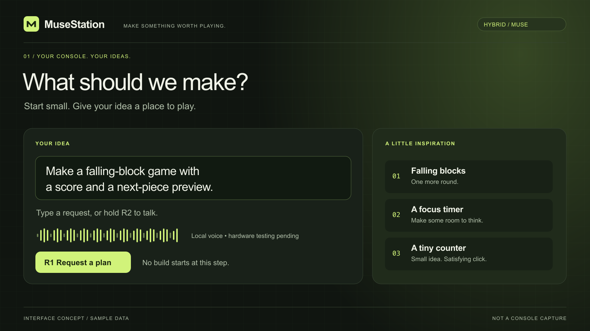
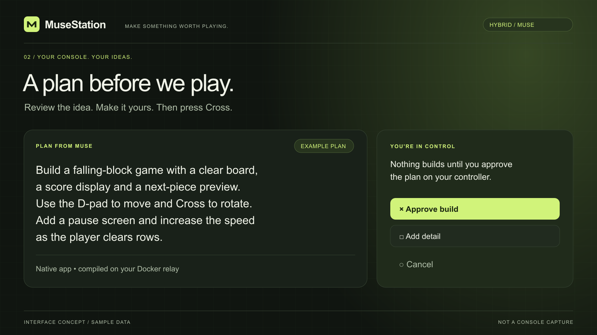
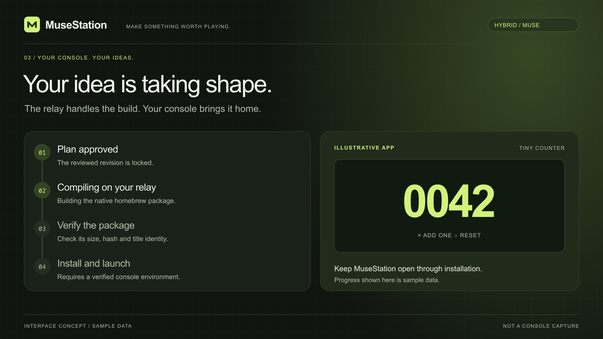
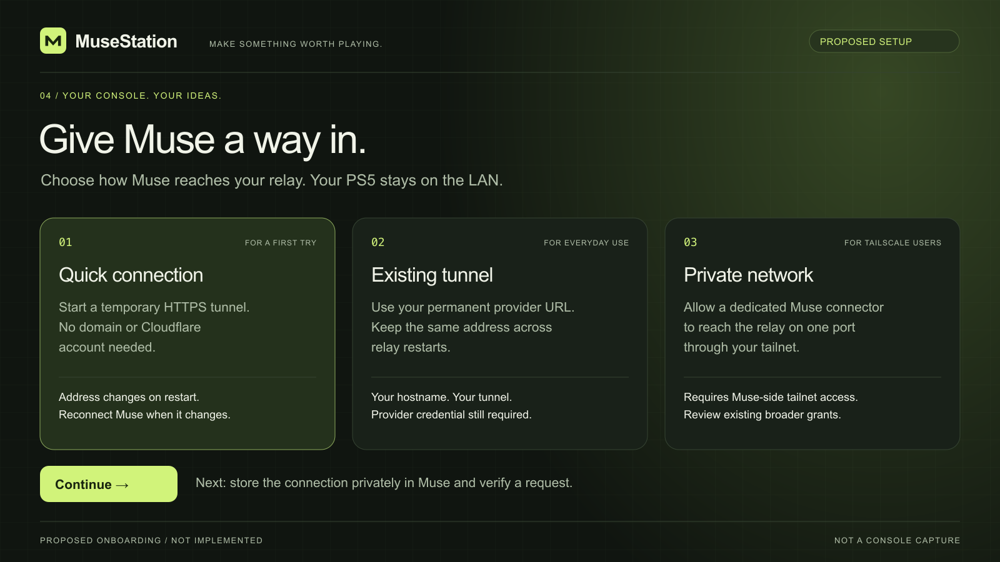

# MuseStation · interface concepts

An exploration of a creation studio that feels at home on the couch: large type,
clear controller actions, a quiet dark canvas and one bright accent.

**These are design mockups with sample data, not PS5 screenshots.** The example
plans and app art were written for these images; they were not generated by Muse.
The native interface currently has a different visual treatment. These assets
do not change the app or establish console behavior, speed or compatibility.

[Back to the project](../../README.md) ·
[Actual native implementation](../../native/src/view.cpp) ·
[Build evidence](../BUILD-REPORT-INVENTORY.md) ·
[Discord introduction](../discord-post.txt)

## 01 · Start with an idea



Typing, controller input and local voice are represented in the source. The
inspiration cards and layout above are a design proposal. DualSense capture and
speech still need hardware verification.

[Full-size PNG](01-create.png) · [Editable SVG](01-create.svg)

## 02 · A plan before we play



The controller approval gate and revision binding exist in the implementation.
The example plan is illustrative. A real Muse connector must return a plan before
the actual Hybrid workflow can proceed.

[Full-size PNG](02-review.png) · [Editable SVG](02-review.svg)

## 03 · Bring the build home



The relay compile/package path and client download checks have host-test evidence.
Installation and launch still need console testing. The progress states and
counter artwork shown here are sample data, not a generated app demonstration.
The current client also cannot resume an already-approved install session after
reopening; see [current limits](../../README.md#current-limits).

[Full-size PNG](03-build.png) · [Editable SVG](03-build.svg)

## 04 · Connect on your terms



**This wizard is proposed and has not been implemented.** The current deployment
uses manual configuration. The optional Quick Tunnel container and named HTTPS
provider route exist; a Tailscale setup flow and automatic endpoint registration
do not.

A temporary Cloudflare URL changes when recreated and has no uptime guarantee.
Tailscale requires the actual Muse connector to have tailnet access, and a narrow
grant does not override existing broader permissions. These options connect a
relay transport; they do not implement Muse account enrollment.

See [current connection instructions](../MUSE-CONNECT.md),
[Cloudflare Quick Tunnels](https://developers.cloudflare.com/tunnel/get-started/quick-tunnels/)
and [Tailscale grants](https://tailscale.com/docs/reference/syntax/grants).

[Full-size PNG](04-connect.png) · [Editable SVG](04-connect.svg)

## Share or edit

The [project cover](cover.png) is suitable for a community introduction. The
[review screen](02-review.png) shows the core interaction. Keep the visible
concept labels when sharing either image.

SVG files are the editable sources; PNGs are committed for GitHub and chat
previews. All artwork uses text and vector shapes, without external images,
fonts, scripts or runtime dependencies. The SVGs use an Arial/Helvetica/sans-serif
font stack, so text metrics can vary slightly between systems.

To regenerate the PNGs after editing an SVG, install `sharp` in a disposable
directory and use the renderer from the repository root:

```sh
mockup_tools="$(mktemp -d)"
npm install --prefix "$mockup_tools" --no-save --package-lock=false sharp@0.35.4
NODE_PATH="$mockup_tools/node_modules" node scripts/render-mockups.cjs
```

The committed PNGs were rendered with Sharp 0.35.4 and visually inspected at
1600 px width. These are presentation checks, not application or hardware tests.
The artwork follows the repository's GPL-3.0-or-later license.
